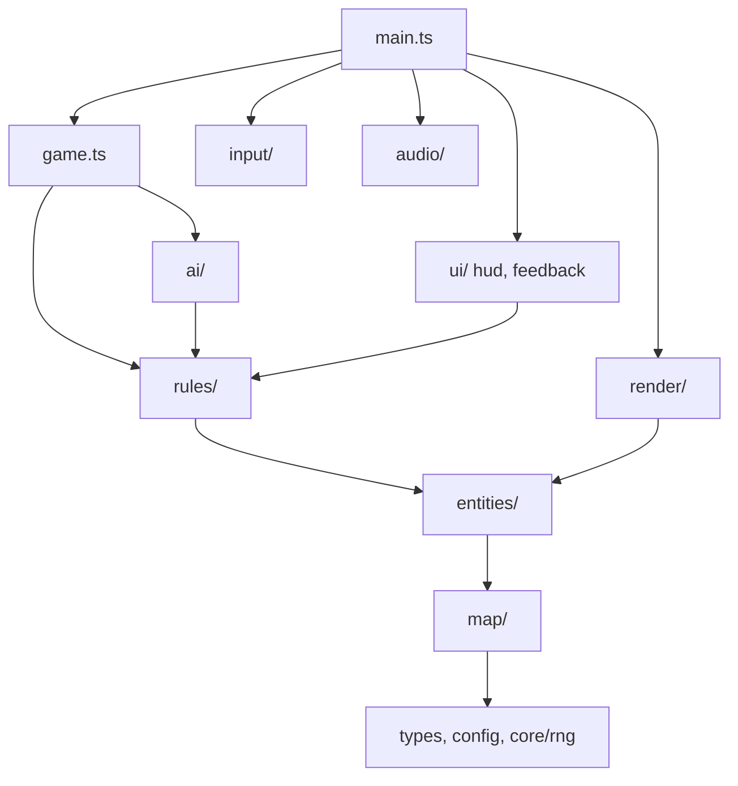

# Architecture

## The core idea

The game is split into two halves that barely know about each other:

- **Simulation** (`map/`, `entities/`, `rules/`, `ai/`, `game.ts`): decides *what happens*. It does not use `document`, `canvas`
  or audio, so it runs the same way in the browser and in the tests (in plain Node).
- **Presentation** (`render/`, `ui/`, `audio/`, `input/`, `main.ts`): shows the state and translates keys into commands.

The only bridge from the simulation to the presentation is the `state.events` queue. The only bridge in the other direction is the `PlayerCommand`
(direction, shoot, aim) that `main.ts` builds every frame.

## Direction of dependencies

A module only imports from modules **above** it. Nothing imports from `main.ts`.



| Folder       | Responsibility                                                                                            |
| ------------ | --------------------------------------------------------------------------------------------------------- |
| `core/`      | `rng.ts`: seeded generator (`createRng`), `shuffle`. The only place that uses `Math.random` is `randomSeed`. |
| `map/`       | Street graph, shortest path, city block discovery, procedural map. Knows nothing about agents.            |
| `entities/`  | Agent, how it moves along the streets, how the player is controlled, creation and trajectory of shots.    |
| `rules/`     | Rules: `territory` (flags, loops, death, respawn), `combat` (projectiles and hits), `match` (scoreboard and end). |
| `ai/`        | Bots: `bot` (3-layer decisions), `perception` (danger), `planner` (loop choice), `combat` (when to shoot). See [BOTS.md](BOTS.md). |
| `game.ts`    | `createGame(seed)` and `update(state, dt, cmd)`: the order of the steps in a frame.                       |
| `render/`    | Camera and drawing on the canvas, in layers.                                                              |
| `input/`     | Keyboard and mouse (`input.ts`) and touch controls (`touch.ts`: floating joystick and buttons; `stick.ts`: the math, pure). Both produce the same thing: direction, "shooting" and the actions. |
| `ui/`        | HTML HUD (`hud`) and the translation event → sound/message (`feedback`).                                  |

## Data model

It's all in [`src/types.ts`](../src/types.ts).

- **`World`**: the finished map. `nodes` (intersections), `edges` (streets), `adj` (neighbors of each node, sorted by angle),
  `faces` (city blocks), `halfEdgeFace` (which block lies on each side of a street) and `paths` (Dijkstra cache).
- **`GameState`**: one match. `world`, `agents`, `bullets`, `particles`, `timeLeft`, `over`, `events`, the seed and the `rng`.
- **`Agent`**: is always *on a street*, from `a` to `b`, `d` pixels from `a`. It can only switch streets at intersections.

> Nodes and faces are always referred to by **index** (`number`). Be careful not to mix them up.

### How city blocks appear

[`map/faces.ts`](../src/map/faces.ts) walks half-edges: each street becomes two (a→b and b→a); at each node we turn to the
street immediately before it in angle, which goes around a face until we return to the start. The face with the largest negative area is the outside of the map and is discarded. Any connected planar graph works.

### How a flag loop captures city blocks

`enclosedFaces` connects the flags by shortest paths (forming a polygon of streets) and captures the blocks whose
`probe` (a point just inside them) falls inside the polygon.

## One frame

`main.ts` calls, in this order:

1. builds the `PlayerCommand` (keys + mouse converted to world coordinates);
2. `update(state, dt, cmd)`: visual effects → clock → each agent (respawn, move, shoot) → flags touched →
   projectiles → victory by percentage;
3. `handleEvents`: empties `state.events` and plays sounds / shows messages;
4. `updateCamera` and `renderer.render`.

The HTML HUD updates in a separate `setInterval` every 120 ms.

## Events

The simulation never says "play this sound" or "write this message", only "this happened":
`shot`, `plant`, `plantRejected`, `loopReady`, `claim`, `claimEmpty`, `chainDestroyed`, `kill`, `matchEnd`.
[`ui/feedback.ts`](../src/ui/feedback.ts) decides how to react. Changing a text or sound doesn't touch the rules, and the tests check the rules by looking at the events.

## Determinism

Map, parks, bot decisions, particles: everything comes from `state.rng`, created from `state.seed`. With the same
seed and the same `dt`, the match is identical (there is a test for this). `?seed=N` in the URL takes advantage of this.

## Map generators

Today there is only the procedural one ([`map/procedural.ts`](../src/map/procedural.ts)), but the rest of the game only sees a `Graph`
(intersections and streets) coming from a `MapSource` ([`map/source.ts`](../src/map/source.ts)). To create another style of map,
implement `build(rng): Graph` and call `createGame(seed, mySource)`. Use the `rng` you receive, never `Math.random`, so that
seeds keep working.

The graph must be **planar** (streets only cross at nodes), **connected** and free of loose nodes. If the scale changes a lot, adjust
`CFG.minFaceArea`.

Performance limits: Dijkstra (`shortestPaths`) is O(N²) per source and `nearestNode` is O(N). Fine up to a few hundred nodes; beyond that, switch to a heap.

## Bot tournament (`npm run sim`)

Since the simulation runs without a screen and with seeds, you can measure the bots instead of judging by eye:
[`sim/tournament.sim.ts`](../sim/tournament.sim.ts) plays hundreds of bot-only matches (agent 0 becomes a bot with
`createGame(seed, { human: false })`) and compares personalities, alternating the corners so a good spawn doesn't favor anyone.

```bash
npm run sim                          # everything, 60 seeds (~5 min)
SEEDS=200 npm run sim                # more matches, less noise
SEED0=5000 npm run sim               # different matches, to confirm without repeating the sample
ONLY="ablation" npm run sim          # only the matchups whose name contains the text
```

In PowerShell: `$env:SEEDS=200; npm run sim`. The output shows, per personality, wins (with the expected "base" if everyone
were equal), average territory and deaths. There are matchups of each personality against the classic, all against all, and
an **ablation** (one new behavior at a time turned on in the classic). With 200 matches the error is about ±3 points:
only trust bigger differences, or confirm with another `SEED0`.

The `CLASSIC` preset reproduces the original bot behavior bit for bit, so it serves as the reference opponent: a
change to the bots is only an improvement if it beats the classic in matches you didn't use to tune it.

## Personality evolution (`npm run evolve`)

[`sim/evolve.sim.ts`](../sim/evolve.sim.ts) automatically searches for good personality parameters (a simple Evolution Strategy;
the algorithm is explained at the top of the file and the results in [BOTS.md](BOTS.md)). It takes ~15 to 20
minutes. Candidates worth keeping go to [`sim/champions.ts`](../sim/champions.ts) and are confirmed in the
tournament, on seeds the search never saw, before going into `config.ts`.

```bash
npm run evolve                            # 25 generations, starting from the greedy one
START=classic EVO_SEED=2 npm run evolve   # another starting point
GENS=40 POP=16 npm run evolve             # bigger search
```

Other settings: `TRAIN_SEEDS`, `SIGMA0`, `FINAL_SEEDS`. Two searches from different starting points that reach
similar regions are the best sign that the result is not just noise.

## Tests

`npm test` runs everything in Node, without a browser:

| File                     | What it covers                                                                   |
| ------------------------ | -------------------------------------------------------------------------------- |
| `graph.test.ts`          | blocks of a known grid, `enclosedFaces`, paths, `pointInPolygon`                 |
| `procedural.test.ts`     | maps always connected, no repeated edges, deterministic; RNG                     |
| `rules.test.ts`          | planting/closing/stealing, repeated flag, maximum, destroying a chain, death, end |
| `simulation.test.ts`     | full bot match (in both shooting modes): no errors, invariants, determinism      |
| `feedback.test.ts`       | events → correct messages and sounds, with fake HUD and sound                    |
| `render.test.ts`         | the renderer goes through all layers without error (fake canvas) and the camera  |
| `stick.test.ts`          | virtual joystick: dead zone, unit direction, radius limit                        |
| `bots.test.ts`           | line of fire, dodging, defense, risk in planning, leader, personalities          |
| `sw.test.ts`             | the real service worker with a fake server and cache: offline, updates, bad network |

What is **not** covered: the real look (pixels), the HUD's HTML and the touch code that manipulates the DOM (`input/touch.ts`).
That is checked by playing (on a phone, or in Chrome's device mode).

## Differences from the original single file

The game behavior was kept. Deliberate changes, all small:

- The `winPct` victory is checked every frame, not every 120 ms (it was in the HUD code).
- The camera keeps responding after the match ends (the `M` key worked, but the camera froze).
- Shuffling the removed streets uses Fisher-Yates (previously `sort(() => rnd() - .5)`, which is biased).
- Maps have a seed (`?seed=`).
- `window.__game` now only exists in development.
