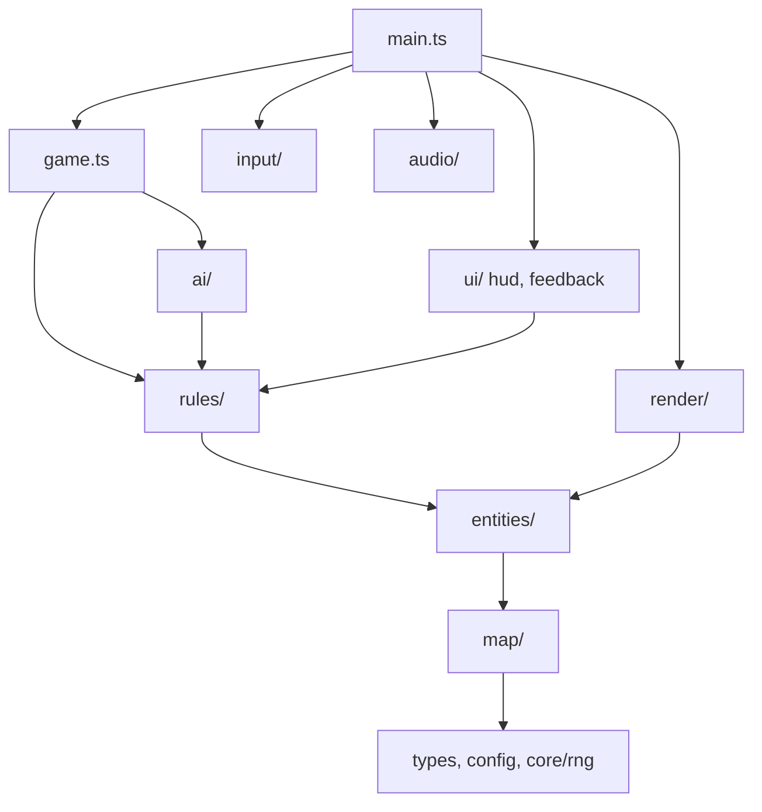

# Arquitetura

## A ideia central

O jogo é dividido em duas metades que quase não se conhecem:

- **Simulação** (`map/`, `entities/`, `rules/`, `ai/`, `game.ts`): decide *o que acontece*. Não usa `document`, `canvas`
  nem áudio, então roda igual no navegador e nos testes (em Node puro).
- **Apresentação** (`render/`, `ui/`, `audio/`, `input/`, `main.ts`): mostra o estado e traduz teclas em comandos.

A única ponte da simulação pra apresentação é a fila `state.events`. A única ponte contrária é o `PlayerCommand`
(direção, atirar, mira) que o `main.ts` monta a cada frame.

## Direção das dependências

Um módulo só importa dos que estão **acima** dele. Nada importa de `main.ts`.



| Pasta        | Responsabilidade                                                                                          |
| ------------ | --------------------------------------------------------------------------------------------------------- |
| `core/`      | `rng.ts`: gerador com semente (`createRng`), `shuffle`. Único lugar que usa `Math.random` é `randomSeed`. |
| `map/`       | Grafo de ruas, caminho mínimo, descoberta de quarteirões, mapa procedural. Não conhece agentes.           |
| `entities/`  | Agente, como ele anda pelas ruas, como o jogador é controlado, criação e trajetória dos tiros.            |
| `rules/`     | Regras: `territory` (bandeiras, laços, morte, renascimento), `combat` (projéteis e acertos), `match` (placar e fim). |
| `ai/`        | Bots: `bot` (decisões em 3 camadas), `perception` (perigo), `planner` (escolha de laços), `combat` (quando atirar). Ver [BOTS.md](BOTS.md). |
| `game.ts`    | `createGame(seed)` e `update(state, dt, cmd)`: a ordem das etapas de um frame.                            |
| `render/`    | Câmera e desenho no canvas, em camadas.                                                                   |
| `input/`     | Teclado e mouse (`input.ts`) e controles de toque (`touch.ts`: joystick flutuante e botões; `stick.ts`: a matemática, pura). Os dois geram a mesma coisa: direção, "atirando" e as ações. |
| `ui/`        | HUD em HTML (`hud`) e a tradução evento → som/mensagem (`feedback`).                                      |

## Modelo de dados

Está todo em [`src/types.ts`](../src/types.ts).

- **`World`**: o mapa pronto. `nodes` (cruzamentos), `edges` (ruas), `adj` (vizinhos de cada nó, ordenados por ângulo),
  `faces` (quarteirões), `halfEdgeFace` (qual quarteirão fica de cada lado de uma rua) e `paths` (cache de Dijkstra).
- **`GameState`**: uma partida. `world`, `agents`, `bullets`, `particles`, `timeLeft`, `over`, `events`, a semente e o `rng`.
- **`Agent`**: está sempre *numa rua*, de `a` até `b`, a `d` pixels de `a`. Só pode trocar de rua nos cruzamentos.

> Nós e faces são sempre referidos por **índice** (`number`). Cuidado pra não trocar um pelo outro.

### Como os quarteirões aparecem

[`map/faces.ts`](../src/map/faces.ts) percorre meias-arestas: cada rua vira duas (a→b e b→a); em cada nó viramos pra rua
imediatamente anterior em ângulo, o que contorna uma face até voltar ao início. A face de maior área negativa é a de fora
do mapa e é descartada. Qualquer grafo planar conexo funciona.

### Como um laço de bandeiras captura quarteirões

`enclosedFaces` liga as bandeiras por caminhos mínimos (formando um polígono de ruas) e captura os quarteirões cujo
`probe` (um ponto logo dentro deles) cai dentro do polígono.

## Um frame

`main.ts` chama, nesta ordem:

1. monta o `PlayerCommand` (teclas + mouse convertido pro mundo);
2. `update(state, dt, cmd)`: efeitos visuais → relógio → cada agente (renascer, andar, atirar) → bandeiras tocadas →
   projéteis → vitória por porcentagem;
3. `handleEvents`: esvazia `state.events` e toca sons / mostra mensagens;
4. `updateCamera` e `renderer.render`.

O HUD em HTML atualiza num `setInterval` de 120 ms, à parte.

## Eventos

A simulação nunca diz "toque este som" ou "escreva esta mensagem", só "isso aconteceu":
`shot`, `plant`, `plantRejected`, `loopReady`, `claim`, `claimEmpty`, `chainDestroyed`, `kill`, `matchEnd`.
Quem decide como reagir é [`ui/feedback.ts`](../src/ui/feedback.ts). Mudar um texto ou som não toca nas regras, e os
testes conferem as regras olhando os eventos.

## Determinismo

Mapa, parques, decisões dos bots, partículas: tudo vem de `state.rng`, criado a partir de `state.seed`. Com a mesma
semente e o mesmo `dt`, a partida é idêntica (há um teste pra isso). `?seed=N` na URL aproveita isso.

## Geradores de mapa

Hoje só existe o procedural ([`map/procedural.ts`](../src/map/procedural.ts)), mas o resto do jogo só enxerga um `Graph`
(cruzamentos e ruas) vindo de um `MapSource` ([`map/source.ts`](../src/map/source.ts)). Pra criar outro estilo de mapa,
implemente `build(rng): Graph` e chame `createGame(seed, minhaFonte)`. Use o `rng` recebido, nunca `Math.random`, pra
manter as sementes funcionando.

O grafo precisa ser **planar** (ruas só se cruzam em nós), **conexo** e sem nós soltos. Se a escala mudar muito, ajuste
`CFG.minFaceArea`.

Limites de desempenho: o Dijkstra (`shortestPaths`) é O(N²) por origem e `nearestNode` é O(N). Bom até algumas centenas
de nós; pra mais que isso, troque por um heap.

## Torneio de bots (`npm run sim`)

Como a simulação roda sem tela e com semente, dá pra medir os bots em vez de julgar no olho:
[`sim/tournament.sim.ts`](../sim/tournament.sim.ts) joga centenas de partidas só de bots (o agente 0 vira bot com
`createGame(seed, { human: false })`) e compara personalidades, com os cantos alternados pra um spawn bom não favorecer ninguém.

```bash
npm run sim                          # tudo, 60 sementes (~5 min)
SEEDS=200 npm run sim                # mais partidas, menos ruído
SEED0=5000 npm run sim               # partidas diferentes, pra confirmar sem repetir a amostra
ONLY="ablação" npm run sim           # só os confrontos cujo nome contém o texto
```

No PowerShell: `$env:SEEDS=200; npm run sim`. A saída mostra, por personalidade, vitórias (com a "base" esperada se todos
fossem iguais), território médio e mortes. Há confrontos de cada personalidade contra o clássico, todos contra todos e
uma **ablação** (um comportamento novo por vez ligado no clássico). Com 200 partidas o erro é de uns ±3 pontos:
só confie em diferenças maiores, ou confirme com outro `SEED0`.

O preset `CLASSIC` reproduz o comportamento original dos bots bit a bit, então serve de adversário de referência: uma
mudança nos bots só é melhoria se vencer o clássico em partidas que você não usou pra ajustá-la.

## Evolução de personalidades (`npm run evolve`)

[`sim/evolve.sim.ts`](../sim/evolve.sim.ts) procura automaticamente bons parâmetros de personalidade (uma Estratégia
Evolutiva simples; o algoritmo está explicado no topo do arquivo e os resultados em [BOTS.md](BOTS.md)). Leva ~15 a 20
minutos. Os candidatos que valem a pena guardar vão pra [`sim/champions.ts`](../sim/champions.ts) e são confirmados no
torneio, em sementes que a busca nunca viu, antes de entrar em `config.ts`.

```bash
npm run evolve                            # 25 gerações, partindo do guloso
START=classic EVO_SEED=2 npm run evolve   # outro ponto de partida
GENS=40 POP=16 npm run evolve             # busca maior
```

Outros ajustes: `TRAIN_SEEDS`, `SIGMA0`, `FINAL_SEEDS`. Duas buscas de pontos de partida diferentes que chegam a
regiões parecidas são o melhor sinal de que o resultado não é só ruído.

## Testes

`npm test` roda tudo em Node, sem navegador:

| Arquivo                  | O que cobre                                                                      |
| ------------------------ | -------------------------------------------------------------------------------- |
| `graph.test.ts`          | quarteirões de uma grade conhecida, `enclosedFaces`, caminhos, `pointInPolygon`   |
| `procedural.test.ts`     | mapas sempre conexos, sem arestas repetidas, determinísticos; RNG                 |
| `rules.test.ts`          | fincar/fechar/roubar, bandeira repetida, máximo, destruir cadeia, morte, fim     |
| `simulation.test.ts`     | partida inteira com bots (nos dois modos de tiro): sem erro, invariantes, determinismo |
| `feedback.test.ts`       | eventos → mensagens e sons certos, com HUD e som falsos                          |
| `render.test.ts`         | o renderer percorre todas as camadas sem erro (canvas falso) e a câmera           |
| `stick.test.ts`          | joystick virtual: zona morta, direção unitária, limite do raio                    |
| `bots.test.ts`           | linha de fogo, desvio, defesa, risco no planejamento, líder, personalidades       |

O que **não** é coberto: a aparência real (pixels), o HTML do HUD e o código de toque que mexe no DOM (`input/touch.ts`).
Isso se confere jogando (no celular, ou no modo de dispositivo do Chrome).

## Diferenças em relação ao arquivo único original

O comportamento de jogo foi mantido. Mudanças deliberadas, todas pequenas:

- A vitória por `winPct` é checada a cada frame, não a cada 120 ms (estava no código do HUD).
- A câmera continua respondendo depois do fim da partida (a tecla `M` funcionava, mas a câmera congelava).
- O embaralhamento das ruas removidas usa Fisher-Yates (antes `sort(() => rnd() - .5)`, que é enviesado).
- Mapas têm semente (`?seed=`).
- `window.__game` agora só existe em desenvolvimento.
